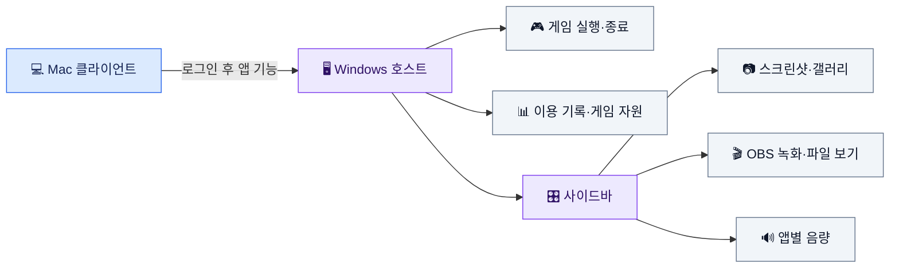
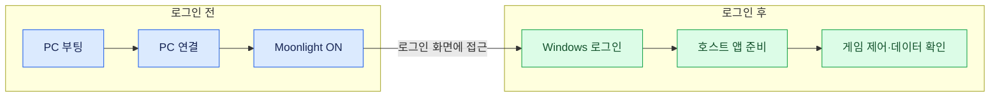

# HomeworkHelper

**게임 실행부터 이용 기록, 원격 연결까지.**
Windows 게임 PC와 Mac을 연결하는 개인용 보조 앱입니다.

**호스트 릴리스 [v1.4.0](https://github.com/lsh930309/HomeworkHelperServer/tree/v1.4.0)** · Windows 호스트 · macOS 원격 클라이언트

## 한눈에 보기

| 원하는 일 | 사용하는 곳 |
|---|---|
| 🎮 게임·프로그램 실행과 종료 | Windows 메인 창 · 사이드바 · Mac 클라이언트 |
| ⏱️ 이용 시간·기록 확인 | 호스트 앱 · 대시보드 |
| ⚡ 게임 자원·회복 시간 확인 | 호스트 앱 · Mac 클라이언트 |
| 📷 촬영·갤러리·음량·녹화 | Windows 사이드바 |
| 🌙 원격 부팅·Moonlight 연결 | Mac 클라이언트 |

## v1.4의 원격 사용 흐름

- **로그인 전**: Tailscale·Apollo가 준비된 PC에 Moonlight로 연결합니다.
- **로그인 후**: 호스트 앱이 준비되면 게임 제어와 데이터 기능을 사용합니다.
- **평소 실행**: 앱은 일반 권한으로, 필요한 관리자 작업은 별도 Windows 서비스로 처리합니다.

스크린샷은 호스트 앱이 촬영하고, 녹화는 OBS와 연동합니다. 녹화 품질·저장 위치는 OBS에서 설정합니다.
지원하는 게임의 자원은 종료 후에도 조회하며, 예상 회복값과 같으면 기존 타이머를 유지합니다.

## 시작하기

| 안내 | 문서 |
|---|---|
| 🧭 설치·개발·진단·검증·배포의 시작점 | [종합 작업 가이드](docs/WORK_GUIDE.md) |
| 🔗 원격 연결과 페어링 | [원격 설정 가이드](docs/remote/setup-guide.md) |
| 📦 패키지 빌드 · Windows 설치 | [빌드 가이드](docs/guides/build-guide.md) · [Windows 설치 가이드](docs/guides/windows-package-install-guide.md) |

세부 동작은 [호스트 수명주기](docs/development/windows-host-lifecycle.md)와
[데이터 안전 정책](docs/data-safety-policy.md)이 소유합니다. README 유지관리 규칙은 [AGENTS.md](AGENTS.md)를 따릅니다.
