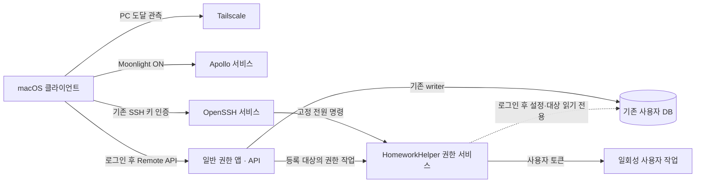

# Windows 호스트 수명주기와 권한 계약

## 사용자 동작

`lsh-desktop`은 사용자 로그인 전에도 Tailscale로 도달하고 Apollo/Moonlight로 로그인
화면에 접근할 수 있어야 한다. 이 상태를 전체 HomeworkHelper 준비 완료로 표시하지 않는다.
게임 데이터, 자동 출석, 게임 실행 등 전체 기능은 지정 사용자의 로그인과 앱 준비 이후 제공한다.
앱과 API는 일반 사용자 권한으로 실행하고 관리자 작업만 Windows 서비스에 요청한다.
설치·업데이트 시 승인은 필요하지만 정상 운영 중 UAC를 표시하지 않는다.

## 구조와 권위



- Tailscale와 Apollo는 Windows 자동 시작 서비스로 로그인 전 연결을 제공한다.
- 권한 서비스는 SYSTEM으로 실행하며 네트워크 포트를 열지 않는다. Windows SCM이
  수명주기를 관리한다. Qt, API, DB writer, 자동 출석은 서비스에 로드하지 않는다.
- 앱/API가 기존 사용자 데이터의 writer다. 권한 서비스는 로그인한 지정 사용자의
  설정과 등록 대상만 읽기 전용으로 조회하며 파일·디렉터리·DB를 만들거나 migrate하지 않는다.
- 설치 시 지정한 사용자 SID는 서비스 설치 설정의 단일 권위다. 초기 운영 대상은
  `lsh-desktop`의 `lsh93`다. 다른 사용자에게 자동 전환하지 않는다.
- 서비스에 게임 DB 복제본, 별도 페어링 저장소, 대상별 관리자 승인 목록을 만들지 않는다.

서비스의 SQLite 연결은 기존 DB에 `mode=ro`로 연결한다. 테이블·스키마·설정·게임 기록을
쓰지 않으며 없는 DB는 만들지 않는다. WAL 모드의 SQLite는 읽기에도 통상적인 `-wal`·`-shm`
공유 파일과 읽기 잠금을 사용할 수 있다. 이 동작을 별도의 앱 상태나 DB writer로 취급하지
않으며, live WAL을 무시하는 `immutable` 읽기나 DB 복제본으로 우회하지 않는다.

## 로그인과 권한

`run_on_startup`은 자동 시작 여부의 단일 설정이다. 지정 사용자의 로그인 이벤트에서
일반 사용자 토큰으로 앱을 한 번 시작한다. 잠금 해제는 로그인으로 처리하지 않고,
사용자가 닫은 앱을 반복 재시작하지 않는다. 기존 Startup 바로가기와 관리자/일반 예약
작업은 설치 전환 시 제거한다. GUI가 API를 소유하는 기존 수명주기는 유지한다.

로그인 이벤트는 서비스 초기화 중에도 보존한다. 서비스 시작 전의 기존 로그인과 초기화
중 도착한 신규 요청을 구분한다. 콜백은 전달 후 신속히 반환하며 한 실행 경계가 준비·
시작·완료를 소유한다. 일시 세션·토큰·설정 준비 실패는 1초 간격, 최대 120초 재확인한다.
설정 꺼짐, 이미 실행 중 확인, 실제 프로세스 생성에서만 완료 처리한다. 설정 없음·손상은
추측 실행 없이 기록한다. SID·세션·로그온을 확인하고 로그아웃·전환·중지 시 요청을 종료한다.
서비스 재시작은 기존 로그인에서 사용자가 닫은 앱을 다시 여는 사유가 아니다.

OBS는 지정 사용자 로그온, 정상 DB 준비 후 호스트 앱 시작, 명시적인 녹화/재연결 요청에서
준비한다. 로그온과 앱 시작은 앱 자동 시작·녹화 설정과 무관하다. 로그온 자동 시작과
`launch_obs` IPC의 확인·생성은 기존 서비스 작업 스레드 한 곳에서 순서대로 처리한다.
앱은 초기화당 한 번 비동기로 요청하며 설정 저장·화면 열기·주기 조회는 실행 트리거가 아니다.
사용자 종료·충돌·잠금 해제·절전 복귀·서비스 재시작으로 OBS를 반복 실행하지 않는다.
실행 경로는 지정 사용자 읽기 경계에서 OBS 설치 정보를 자동 감지하고, 숨김 설정만 기존 DB에서 읽는다. 같은 경로·SID·세션의 상승 OBS는 재사용하고
일반 권한 OBS는 강제 종료하지 않는다. 경로·토큰 오류는 앱의 일반 권한 시작을 막지 않는다.
숨김 실행은 `--minimize-to-tray`, 작업 디렉터리는 OBS 실행파일의 부모 폴더를 사용한다.
일반 앱은 OBS를 직접 생성하지 않고 기존 고정 IPC `launch_obs`만 사용한다. IPC 작업 대기는
최대 4초이며 시간 초과·세션 변경·서비스 중지 뒤 대기 작업은 늦게 실행하지 않는다.
이미 실행에 착수해 결과가 불명확하면 자동 재전송하지 않고 다음 요청에서 실제 프로세스를
확인한다. OBS 실행과 WebSocket 연결은 별도로 판정하며 연결 실패로 프로세스를 재실행하지
않는다. 녹화는 사용자가 요청할 때 시작하고, 호스트 앱 종료도 OBS를 종료하는 사유가 아니다.

### OBS 연동 설정의 권위와 사용자 흐름

OBS는 포트·인증·현재 프로필·녹화 저장 위치·녹화 품질을 소유한다. HomeworkHelper는
같은 PC의 OBS에만 연결하며, 사용자에게 주소·포트·비밀번호·실행 경로·녹화 폴더를
다시 입력하게 하지 않는다. 이 값들의 DB 모델·API·설정 writer·수동 우선 경로를 제거한다.
기존 SQLite 열은 삭제하거나 재작성하지 않지만 제품에서 읽거나 쓰지 않는다. R23의
편집 항목과 저장 범위 불일치는 이 중복 편집·저장 경계를 없애 해소한다.

앱의 사용자 설정은 녹화 기능 사용·사이드바 녹화 파일 표시·OBS 최소화 실행·게임패드
홀드 시간(실제 판정과 같은 500~2000ms)이다. 실행 파일은 기존 Windows 설치 레지스트리와 기본 설치 위치에서 찾는다.
서비스는 사용자 impersonation 안에서 같은 설치 탐지 함수를 호출하며 OBS WebSocket
비밀번호·프로필은 읽지 않는다. SYSTEM 경로나 사용자 DB의 과거 실행 경로를 대신 쓰지 않는다.

앱 초기화·명시적 녹화/재연결은 기존 실행 트리거를 유지한다. WebSocket 접속 정보는
OBS 설정 파일을 읽으며 읽기 실패·서버 꺼짐·잘못된 포트/인증 값은 명시적으로 실패한다.
기본 포트·빈 비밀번호로 오류를 숨기거나 OBS 설정을 변경하지 않는다. 녹화 기능을 끄면
제어 연결만 해제하고 진행 중인 OBS 녹화와 프로세스를 중지하지 않는다.

녹화 제어와 기존 파일 조회는 독립된 기능이다. `recording_enabled`는 WebSocket 연결과
녹화 버튼을, `obs_watch_output_dir`는 파일 목록을 제어한다. 녹화 제어를 꺼도 파일 표시가
켜져 있으면 기존 녹화 파일을 볼 수 있다. 앱 시작 시 연결 여부와 무관하게 폴더를 읽으며,
OBS가 연결되지 않았으면 현재 프로필 INI를 읽는다. 연결 성공·재연결·녹화 시작 준비 때는
`GetRecordDirectory`로 실제 출력 폴더를 확인한다. 사이드바는 이 관측값을 사용하고 수동
폴더나 ~/Videos로 대체하지 않는다. 연결·실행 실패는 확인된 파일 정보를 지우지 않고,
폴더 조회 실패는 파일 정보를 미확인으로 표시하되 연결·녹화 제어를 중단하지 않는다. 설정
화면 열기는 기존 작업 스레드의 읽기 요청만 수행하며 OBS 실행·녹화·새 연결을 요청하지 않는다.
설정 화면은 'OBS 연동', 짧은 상태, 읽기 전용 실행 파일/녹화 폴더와 '다시 연결'을 제공한다.
비밀번호를 화면·진단·DB 투영으로 복제하지 않는다. 조회 실패는 원인을 표시하고 해당
조회가 성공하면 해제한다. 미해결 실행·연결 오류는 별도로 유지한다. '다시 연결'은 저장된
녹화 기능 사용 설정과 화면의 선택이 모두 켜진 경우에만 허용한다. 저장 전 활성화에는
'녹화 기능 사용을 저장한 뒤 다시 연결하세요.'를 안내한다.

현재 연결 작업 스레드가 연결·설정 조회·녹화 시작 준비를 소유한다. GUI 스레드에서
WebSocket 응답을 기다리지 않는다. 종료·기능 끄기 뒤 늦은 완료는 연결/녹화를 되살리지 않는다.
프로필·장면·인코더·OBS 설정 파일은 쓰지 않는다. 스크린샷은 기존 HomeworkHelper 자체
캡처와 저장 폴더를 유지하며 OBS 녹화 폴더와 합치지 않는다.

| 검증 시나리오 | 유지할 결과 |
| --- | --- |
| 과거 DB의 잘못된 OBS 주소/인증/폴더 | 사용하지 않음; 실제 OBS 설정으로 연결·파일 조회 |
| OBS에서 포트/인증 변경 후 재연결 | 새 OBS 값으로 연결, 저장 과정과 자동 녹화 없음 |
| OBS 녹화 폴더 변경 후 녹화 시작 준비 | 실제 출력 폴더를 조회해 사이드바 갱신 |
| OBS 없음/설정 없음/손상/서버 꺼짐 | 명시적 실패; OBS·운영 DB 설정 변경 없음 |
| 연결·실행 실패, 읽을 수 있는 현재 프로필 | 파일 목록 유지; 녹화 제어만 연결 안 됨 (R26) |
| 폴더 조회 실패, 정상 WebSocket | 파일 정보 오류 표시; 연결·녹화 제어 유지 (R26) |
| 녹화 제어 꺼짐·파일 표시 켜짐 | 파일 목록만 표시; 재연결 요청·OBS 추가 실행 없음 (R27) |
| 폴더 조회 실패 후 성공 | 조회 오류 해제; 미해결 실행·연결 오류 유지 (R28) |
| 설정 화면 열기·앱 설정 저장 | OBS 실행 없음; 메타데이터 저장은 연결을 끊지 않음 |
| 녹화 기능 끄기·앱 종료·늦은 응답 | OBS 녹화 유지; 종료 후 연결/녹화 재개 없음 |
| 실행 탐지·중복 로그온/앱 시작 | 지정 사용자 상승 OBS 재사용, 기존 실행 소유자 유지 |


`run_as_admin`은 관리자 기능 사용 여부다. 설정 변경은 앱을 재시작하지 않고 다음
작업에 적용한다. 일반 게임은 기본 사용자 토큰, 기존 관리자 정책상 상승 대상은
로그인한 관리자의 linked token으로 실행한다. 토큰이 없거나 표준 사용자이면 상승
작업을 거부한다. SYSTEM 토큰으로 게임을 대신 실행하지 않는다.

등록 게임 종료도 지정 사용자의 연결된 관리자 토큰으로 수행한다. SYSTEM 서비스는
인증·등록 대상 조회·세션 선택을 소유하고, 실제 종료는 같은 실행 파일의 일회성
`--user-stop` 작업에 위임한다. 게임 이름이나 EXE 이름별 예외는 두지 않는다.
서비스가 선택한 프로세스들의 PID·생성 시각·경로·SID·Windows 세션과 로그온 식별을
전달하고, 사용자 작업이 모든 대상의 열린 핸들을 검증한 뒤 그 핸들로 종료한다.
사용자 작업의 실제 토큰·현재 콘솔 세션·로그온도 확인한다. 검증 실패 시 종료하지 않는다.
`TerminateProcess` 성공은 종료 명령 수락이며 드라이버·I/O 정리 완료를 뜻하지 않는다.
사용자 작업은 명령 전달 결과로 끝내고, 작업 대기는 4초·작업 정리는 250ms로 제한해
기존 5초 IPC 응답 기한 안에 결과를 전달한다. 프로세스 정리를 기다리며 공유 pipe와
감시를 막지 않는다. `accepted`와 기존 대상 목록 `stopped`는 종료를 요청한 대상이며,
실제 프로세스 소멸과 이용 기록 종료는 기존 감시만 판정한다. 오류·작업 시간 초과는
명령 수락으로 표시하거나 SYSTEM 종료·UAC·자동 재전송으로 우회하지 않는다.
여러 일치 프로세스도 요청당 사용자 작업 한 번으로 처리하고, 부분 실패는 전체 성공으로
표시하지 않는다. 이용 기록은 기존 모니터링이 실제 종료를 관측한 뒤 저장한다.

macOS 클라이언트는 기존 종료 확인 작업에서 최대 60초 동안 최신 프로세스 상태를
재조회한다. 이 기간에는 같은 게임의 실행·종료 요청을 중복 제출하지 않는다. 기한 내
정리 완료를 확인하지 못하면 종료 미확인으로 안내하고 요청의 집중 확인만 끝낸다.
일반 감시는 계속하고 프로세스를 꺼짐으로 보정하거나 종료 명령을 재전송하지 않는다.
종료 미확인 안내는 다음 정상 프로세스 조회에서 일반 상태 갱신 안내로 교체한다.
실행 중 여부는 최신 게임 행만 표시하고, 이후 다른 작업이나 오류의 안내는 덮어쓰지 않는다.
사이드바도 명령 수락을 실제 종료 완료로 표시하지 않는다. 새 영속 상태·DB 열·API·
서비스·권한 경로를 추가하지 않는다.

서비스 장애·미등록 시 일반 기능은 유지하고 권한 작업은 명시적으로 실패한다.
ShellExecute `runas`, 임시 예약 작업 등 자동 상승 fallback은 제공하지 않는다.
게임·런처 재시작 확인 등 사용자 의사결정은 일반 앱에서 마친 뒤 권한 작업을 요청한다.

## 미디어 센터와 게임 소리 정책

미디어 센터는 로그온한 일반 권한 GUI 안에서 실행한다. 기존 ProcessMonitor가 실행 게임의
유일한 소유자이며 미디어 기능은 불변 스냅샷만 소비한다. SYSTEM 서비스·HTTP 포트·브라우저
확장·Firefox 원격 디버깅·Spotify Web API 인증을 추가하지 않는다. 화면 구성은
[GUI 계약](windows-gui-modernization.md#미디어-센터-목업과-배치)을 따른다.

### 재생 관측과 명령

- Windows GSMTC가 게시하는 앱별 세션을 관측한다. 앱 ID와 세션 identity를 구분하고,
  같은 앱의 세션이 여러 개면 임의 대상을 선택하지 않는다. 최초 BGM 대상은 설치 Spotify다.
- `play`, `pause`, `previous`, `next`는 선택한 세션에 명시적으로 보낸다. 전역 미디어키나
  Play/Pause 토글을 사용하지 않는다. Spotify 실행은 명시적 준비·재생 요청 또는 허용된
  신규 자동 재생 계기에서 `spotify:` 프로토콜로 한 번 요청하며 세션이 없어도 반복 실행하지 않는다.
- 사용자 재생 조작은 미디어 세션의 실제 결과를 표시한다. 명령 접수·수락·실제 재생은
  구분하고 실패를 로그와 상태 결과에 남긴다. BGM의 재생 상태를 유지하는 감시 루프는 없다.
- 관측과 명령은 GUI 밖의 단일 실행 경계에서 직렬 처리한다. 늦은 play는 최신 게임·미디어
  조건을 다시 확인하며 취소·종료 뒤 대기 명령을 실행하지 않는다. 운영 DB는 미디어 작업이 쓰지 않는다.

미디어 기능은 정상 DB 초기화·기존 세션 점검 후 첫 프로세스 감시 결과를 받은 시점에 한 번
시작한다. 이미 실행 중인 게임을 먼저 반영한 뒤 초기 BGM 조건을 판단한다. 최초 시작의
실패를 주기 감시나 사이드바 재표시로 반복 재시도하지 않는다. 사용자가 먼저 옵션을 고르면
이후 초기화가 기본값으로 덮지 않는다. 자동 BGM·비활성 음소거·자동 포커싱 옵션은 해당 실행
동안만 유지하며 기존 설정이나 DB 스키마를 추가하지 않는다. 라이브러리 최초 import 시 STA를
초기화하는 [pywin32](https://github.com/mhammond/pywin32/blob/main/com/win32com/src/PythonCOM.cpp)와
[comtypes](https://github.com/enthought/comtypes/blob/main/comtypes/__init__.py)는 활성화하는
GUI 스레드에서 먼저 로드하고, 작업 스레드가 MTA 초기화·오디오·미디어 정리를 소유한다.
게임·포커스 관측 간격은 250ms이며 느린 비동기 미디어 조회가 이 관측을 막지 않게 한다.

### 자동 BGM 트리거

자동 기능은 명시적으로 활성화할 때 한 번 판단하며, 이후 의미 있는 게임 소리 조건의 전환에서만
재생을 요청한다. 동일 관측·설정 재적용·사이드바 표시·절전 복귀·대상 세션 재등장 자체는 재생
계기가 아니다. 사용자가 BGM을 일시정지하거나 종료해도 같은 조건에서 다시 틀지 않는다.

| 전환 | 동작 |
|---|---|
| 자동 기능 켜기, 다른 미디어가 재생하지 않고 게임 소리가 필요하지 않음 | Spotify 재생 한 번 요청 |
| 포커스된 게임의 사용자 음소거 꺼짐·음량이 0보다 큼 | BGM 일시정지 |
| 게임 종료·실제 외부 창 전환·사용자 음소거/0%로 게임 소리가 불필요해짐 | 다른 미디어 재생 및 미디어 정지 후 보류가 없을 때 BGM 재생 한 번 요청 |
| 다른 미디어가 Playing으로 진입 | BGM 일시정지, 해당 미디어 우선 보류 |
| 다른 미디어 Paused·Stopped·세션 제거·끝 위치 도달 | 자동 재생하지 않음; 일시정지와 완전 종료를 추측하지 않음 |
| 사용자의 명시적 BGM 재생/자동 기능 다시 켜기 | 미디어 우선 보류를 해제하고 새 요청으로 처리 |
| 자동 기능 끄기 | 이후 자동 재생·일시정지 없음 |

미디어 정지 후 보류는 런타임 정책이며 DB에 쓰지 않는다. 중복 알림이나 포커스 갱신이 이 보류를
우회하지 않는다. 자동 재생은 다른 미디어의 실제 Playing이 없어야 하며, 명시적인 사용자
재생 조작은 자동화와 구분한다. 짧은 소리 겹침은 허용하며 무음 선점이나 전역 고속 프로세스 스캔을
추가하지 않는다. 실제 세션 관측 실패·게임 음량 미확인은 무음으로 간주하지 않는다.
비활성 게임 자동 음소거를 켠 상태에서는 배경 게임의 적용·조회 실패도 포함한다.
전경이 게임이 아니더라도 배경 게임의 무음이 확인되기 전에는 BGM 자동 재생을 보류한다.

### 비활성 게임 음소거

사용자 의도는 기존 `default_muted`·`default_volume`이 소유한다. 실제 mute writer 한 곳에서
`사용자 음소거 OR (자동 음소거 활성 AND 게임이 비활성)`을 계산한다. 자동 결과를 사용자
기본값으로 저장하지 않는다. 포커스 복귀 때에도 사용자 음소거·0%는 유지하며 호스트 자체의
보조 창 조작은 직전 외부 창의 컨텍스트를 유지한다. 외부 Windows 믹서의 값 변화는 구분하여
보고하며 값이 바뀌지 않는 조작 의도까지 알아냈다고 주장하지 않는다.

PID·생성 시각·경로·현재 사용자 세션이 같은 대상으로만 적용한다. 관련 오디오 세션 전체와
늦게 생긴 세션을 처리하고 앱 종료·기능 해제·DB 복구 준비 시 사용자 기본 음소거로 되돌린다.
Windows 자체의 세션 값 보존 때문에 프로세스 비정상 종료 뒤에는 정상 재진입 시 사용자
기본값과 현재 정책으로 다시 판정한다. 정책 장애가 게임 감시·이용 기록을 중단시키면 안 된다.

### 신규 게임 창 자동 포커싱

기존 창 바로가기의 identity 확인과 Windows 전환 API를 재사용한다. 첫 감시 스냅샷 및 앱 시작
전부터 존재한 프로세스는 포커싱하지 않는다. 이후 새 게임 identity의 창 변화를 최초 감지부터
최대 120초 관찰하고 한 번 전환을 요청한다. 게임 창이 이미 전경이면 그 HWND를 기억하며
대기를 유지한다. 해당 창이 뒤로 가거나 사라져도 이미 전경이었던 같은 창을 다시 끌어오지 않고,
새 HWND로 교체되는지 관찰한다. 창 부재·전경·교체로 최초 마감 시각을 연장하지 않는다.
게임명·창 클래스·창 순번·화면 크기로 최종 로그인 화면이라고 단정하지 않는다.

현재 지정 사용자·세션의 생성 시각과 실제 부모 계보가 같은 게임 실행으로 연결된 자식 창은
시작 과정으로 인정한다. 그 외 외부 창으로 전환하거나 대상 종료·교체·기능 해제·앱 종료 시
대기를 취소한다. 전역 마지막 입력 시각만으로 사용자 선택 의도를 추정하지 않는다.
전환 직전 동일 실행·선택 HWND를 다시 검증하며, API 수락과 실제 전경 상태를 별도로 기록한다.
창이 아직 없는 관찰과 Windows가 거부한 요청의 재시도는 구분한다. 성공·거절 뒤 추가 전환,
가짜 입력·SYSTEM 활성화는 하지 않는다. 배경 시작 창에 이미 요청했다면 이후 교체된 창에
두 번째 요청을 보내지 않는다. 실제 플레이 준비 완료나 모든 Windows 전환 성공은 보장하지 않는다.

### 실환경 검증 시나리오

아래 항목은 사용자가 호스트 시험 준비를 알린 뒤 순차 수행한다. 격리 자동 테스트 통과와
실게임·실Spotify·실Firefox 성공을 구분한다. 실호스트 조작은 사용자의 명시적인 검수 허가를
받은 뒤에만 수행한다. 운영 DB·설정·자격 증명을 격리하고, 소리·창 시험은 소유 fixture를 우선한다.
실제 Spotify 재생 상태를 변경하는 시험은 초기 상태와 복원 결과를 기록하며 재생 위치까지
원복했다고 표현하지 않는다. 고정 검수 명령과 격리 경계는
[공용 운영 도구](../guides/operations-guide.md#설치-전-미디어사이드바-검수)를 따른다.

| 시나리오 | 확인할 실제 결과 |
|---|---|
| Spotify 기존 세션·복수 세션·미실행 | 정확한 대상만 제어; 모호하면 거부; 명시 실행 한 번; UAC 없음 |
| 자동 켜기 → 사용자 pause/앱 종료 → 같은 상태 유지 | 자동 재생·앱 재실행 반복 없음 |
| Firefox 재생 → pause → stop/탭 닫기 | BGM pause 뒤 자동 재개 없음 |
| 미디어 정지 뒤 게임/음량/사이드바 알림 | 미디어 보류 우회 재생 없음; 명시 BGM 재생으로 해제 |
| 명조·니케·젠존제 신규 실행 및 앱 시작 전 기존 게임 | 신규만 창 준비 후 1회 포커스; 기존 게임 포커스 강탈 없음 |
| 창 준비 중 사용자 Firefox 전환·게임 종료·Windows 전환 거부 | 늦은 포커싱·반복 시도 없음 |
| 게임 A/B·Firefox·사이드바 전환 | 실제 활성 게임만 사용자 설정대로 들림; 비활성 게임 mute |
| 사용자 mute·0%·55% → 자동 mute → 복귀 | 저장값 보존; 사용자 mute/0% 임의 해제 없음 |
| 여러/새 오디오 세션·출력 장치 변경·PID 재사용 | 대상 전체 적용; 이전 identity 조작 없음; 실패를 정상으로 표시하지 않음 |
| 기능 끄기·정상 종료·복구 진입·재실행 | 임시 음소거 정리, 대기 명령/포커싱 취소, 기존 감시·DB 정상 |

## 로컬 IPC

서비스 이름은 `HomeworkHelperPrivilege`, 실행 파일은 `homework_helper_service.exe`다.
설치 사용자와 SYSTEM만 접근하는 로컬 named pipe를 사용하고 remote pipe 연결은 거부한다.
실제 클라이언트 PID, 토큰 SID, 설치 이미지 경로와 Windows 세션을 확인한다.
요청 본문의 SID/PID를 인증 정보로 취급하지 않는다.

| 작업 | 입력과 허용 범위 |
| --- | --- |
| `status` | 서비스와 지정 사용자의 현재 로그인 세션 상태 |
| `power` | 지정 사용자 로그온 후 `shutdown`, `restart`, `sleep`만 허용 |
| `launch_obs` | 지정 사용자 로그온 후 OBS 설치 자동 탐지·숨김 설정으로 상승 실행; 요청 경로/인자 없음 |
| `launch_managed` | 등록된 process ID와 기존 실행 모드 |
| `inspect_managed` | 등록된 process ID들의 실행 경로와 일치하는 프로세스 관측 |
| `stop_managed` | 등록 ID와 일치하는 사용자 프로세스; PID 지정 시 생성 시각도 일치해야 함 |

실행 경로와 인자 계산은 공유 순수 함수에서 수행한다. 권한 서비스는 자유 형식 셸 명령이나
등록되지 않은 경로를 IPC로 받지 않는다. 사용자 Shell이 필요한 실행은 해당 사용자 토큰의
일회성 작업 모드에서 수행한다. 작업 모드에 API·GUI·데이터 writer를 로드하지 않는다.
응답은 `accepted`, `status`, `message`와 작업별 관측값을 포함한다. 요청 처리 시작 시
확정한 사용자·Windows 세션·입력만 소비하고 로그아웃이나 세션 변경 후에는 거부한다.
지연 요청을 새 세션에서 재실행하지 않는다.

호스트 화면·원격 API·서비스는 같은 실행 모드 계산을 사용한다. `direct`는 감시 경로,
`shortcut`은 저장된 실행 경로를 선택하며 프리셋·추가 런처 파일 검색을 수행하지 않는다.
`launcher` 모드에서만 프리셋의 검색 목록과 파일 존재를 읽는다. 목록의 누락·null·빈 목록은
모두 검색 후보 없음이며, 기존 저장 경로 선택 규칙을 따른다. 프리셋이나 DB를 고쳐 써서
이를 보정하지 않는다.

| 수정 경계 | 검증할 사용자 계약 |
| --- | --- |
| 실행 모드 | 모든 프리셋에서 직접·저장 경로 실행은 검색 목록과 무관; 런처 검색의 누락·null·빈 목록·실재 후보를 구분 |
| 종료 주체 | 서비스는 SYSTEM에서 게임을 종료하지 않음; 사용자 관리자 토큰 부재 시 거부 |
| 종료 대상 | 등록 경로·사용자·세션·PID·생성 시각 일치; 하나라도 검증 실패하면 종료 시작 안 함 |
| 종료 결과 | 명령 수락과 실제 정리 완료 구분; 지연 정리를 권한 실패로 표시하지 않음; 거부·부분 실패를 수락으로 숨기지 않음 |
| 수명주기 | 새 로그온·사용자 전환에 이전 요청 재사용 안 함; 서비스 실패 시 직접 종료로 우회하지 않음 |

### 프로세스 감시와 시작 점검의 완료 경계

서비스 pipe는 서비스 수명 동안 유지하고 요청 사이에는 연결만 해제한다. 클라이언트는
최대 5초 동안 연결 확보를 기다리며, 다른 클라이언트가 먼저 접속하거나 서비스가 준비
중인 경우 연결 단계만 다시 시도한다. 요청을 전송한 뒤의 실패는 결과 불명확으로 전달하고
실행·종료·전원 명령을 자동 재전송하지 않는다. 실패에는 원본 Windows 오류를 남긴다.

시작 시 열린 게임 기록 점검은 기존 작업·backoff·타이머 경계에서 성공까지 유지한다.
점검 API 성공 후 주기 감시와 정상 heartbeat를 시작하여 이전 heartbeat를 먼저 덮어쓰지
않는다. 성공한 시작 점검은 절전 복귀나 화면 열기 때 반복하지 않는다. 같은 입력의 진행
중 감시는 중복 제출하지 않고, 변경된 입력만 기존 최신 요청으로 교체한다.

서비스 중단·인증 실패·시간 초과는 빈 프로세스 목록이 아니다. 실패한 관측은 실행 중인
게임·PID·세션 기록을 유지하며, 완료된 정상 관측으로만 시작·종료를 판정한다. DB 복구와
앱 종료는 대기 작업을 중지하고 늦은 응답을 반영하지 않는다. 실제 Windows의 동시 연결,
긴 관측, 시작 점검 재시도·중단과 게임 기록 비변경을 격리 데이터로 검증한다.

## 전원 제어

기존 SSH 인증으로 아래 고정 명령을 호출한다.

```powershell
& 'C:\Program Files\HomeworkHelper\homework_helper_service.exe' --control power sleep
```

`shutdown`과 `restart`도 같은 형식을 사용한다. CLI는 로컬 IPC로 서비스에 요청하고,
서비스가 Windows native power API를 호출한다. `rundll32 SetSuspendState`는 사용하지 않는다.
명령 수락 응답과 실제 전원 전환을 구분하고 자동 재전송·강제 종료로 확대하지 않는다.
앱 API의 온라인 여부는 전원 제어 조건이 아니다. 기존 SmartThings Wake는 유지한다.
전원·사용자 권한 작업은 로그온 후 지원 기능이다. 클라이언트는 기존 user_session_ready로
버튼을 허용하고 미로그온 시 "로그온 후 사용"을 안내한다. 로그인 전 Wake와 Moonlight는
독립적으로 유지한다. 로그인 전 권한 작업의 지원 확대는 백로그다.

## 클라이언트 상태

PC 도달 여부는 최신 Tailscale ping, 스트리밍 응답은 Apollo `serverinfo`, 전체 앱 기능은
기존 Remote API 인증과 응답으로 관측한다. 익명 `PairStatus`는 Moonlight 페어링 판정에
사용하지 않는다. 페어링과 Desktop 대상은 기존 Moonlight 설정을 사용한다.
관측과 Moonlight 실행 대상은 HomeworkHelper에 저장된 Base URL의 호스트가 소유한다.
별도 Moonlight host 선택 UI·설정·우선 선택 경로를 두지 않는다. 기존 Moonlight 등록에서
해당 호스트의 주소·이름과 일치하는 Desktop 대상을 찾으며, 관련 없는 등록을 대신 고르지 않는다.
Apollo 응답의 서버 식별자와 등록된 식별자 검증은 유지한다. 서버의 페어링 정보가 실제로
바뀌면 기존 PIN 페어링 절차를 사용하며, 자동 승인하거나 저장된 인증서를 재작성하지 않는다.

| 관측 | 사용자 결과 |
| --- | --- |
| PC/Apollo 응답, API 없음 | 호스트 대기; Moonlight 가능 |
| PC 응답, Apollo 없음 | 스트리밍 대기; Wake 재전송 금지 |
| API 인증 성공 | 기존 페어링됨·동기화 중 표시와 전체 기능 사용 |
| API 인증 거부, Apollo 응답 | 기존 인증 확인 필요 표시; Moonlight 유지 |
| PC 무응답 | 호스트 응답 없음; 물리 전원 꺼짐으로 확정하지 않음 |
| Tailscale 검사 실행 실패 | Tailscale 오류; 검사 생략과 구분 |
| 수락한 power 이후 전환 확인 | 기존 종료·부팅·재시동 대기 중 표시 유지 |

기존 페어링 해제됨·상태 확인 중·페어링됨·동기화 중·종료 대기 중·호스트 꺼짐·
부팅 대기 중·재시동 대기 중·재연결 중·서버 응답 없음·인증 확인 필요 문구는 유지한다.
단순한 네트워크 무응답은 새 호스트 응답 없음으로 표시한다. 별도 호스트 불일치 상태는
표시하지 않으며 Moonlight 등록·페어링 안내는 기존 설정 화면에서 제공한다.

관측 주기는 화면 사용 중 기본 5초(기존 사용자 간격 설정을 존중), 배경에서 15초다. 화면 열기, Mac 복귀, 호스트 변경,
버튼 클릭 시 즉시 관측한다. 호스트 identity가 다른 늦은 응답은 반영하지 않는다.
Moonlight ON과 Wake 후 재개는 전체 앱 API의 `.online`을 요구하지 않는다.
PC가 응답하면 Wake를 보내지 않는다. 게임 조작은 기존 API 인증과 준비를 요구한다.

## 검증과 배포 경계

연결·IPC·토큰·PID·읽기 전용 DB·로그인·지연 응답·installer 전환은 자동 검증한다.
실호스트 사용과 후보 설치·기능 시험은 사용자 승인 범위다. 합성 메시지/격리 데이터와
운영 설치본/물리 전원 시험을 구분하며 자동 테스트 PASS를 확대하지 않는다.

기존 dev-alwayson에서 작업 단위별 검증과 한국어 계층형 commit/push를 수행한다.
작업 실행과 에이전트 사용 규칙은 [AGENTS.md](../../AGENTS.md)를 따른다.
기존 PR #41을 갱신하며 open으로 유지한다. 구현 중 테스트 실패는 해결하고 전체 diff를
직접 코드 리뷰한다. 멀티에이전트 금지 중에는 독립 에이전트 리뷰를 요청하지 않는다.
기존 누적 변경과 이번 변경을 PR에 구분하고 외부 리뷰의 실제 실행 여부를 기록한다.

호스트·클라이언트의 빌드와 패키지 배포는 [빌드 가이드](../guides/build-guide.md)를
먼저 읽고 각 대상 환경의 `build.py` 실행 흐름을 따른다. 운영 DB
백업·정상 종료 뒤 기본 위치에 설치하고 서비스 등록·기존 시작 경로 정리·Tailscale 적용을
검증한다. Tailscale는 기존 설정을 보존하는 set --unattended=true와 종료 코드·timeout·
실제 적용값으로 확인한다. 미적용을 완료로 기록하지 않는다. 설치 디렉터리 선택과 이전
사용자 지정 위치 재사용은 하지 않는다.

DB 복구·게임/자원 쓰기는 [데이터 안전 정책](../data-safety-policy.md), 단일 GUI·네이티브
메시지는 [GUI 검증 문서](windows-gui-modernization.md)를 따른다.

### 실사용 검수 소유권

로그인 전 제품 Moonlight ON으로 로그인 화면 접근과 원격 부팅·게임 실행/종료는 사용자
실사용 확인을 통과했다(R17). 화면 검증은 사용자가 수행하며 에이전트는 명시 요청 때만
대응한다. 검수를 위한 임의 로그아웃·재부팅·종료와 기존 성공 시험 반복을 하지 않는다.
OBS의 다음 실제 로그온 자동 실행은 사용자 확인 전까지 실사용 검수 대기로 기록한다.
Windows 1.4.0 b2 적용 후 니케·명조를 포함한 모든 등록 게임의 실행·종료는 사용자
실사용 확인을 통과했다. 이후 사이드바 표시 보완은 [GUI 표시 계약](windows-gui-modernization.md#사이드바-표시-계약)을
따르며, 기존 실행·종료 동작을 유지한다.
스마트 스케줄(R05)은 미사용 백로그이며 이번 보완에서 변경·제거·비활성화하지 않는다.
macOS UI 잘림(R14)은 사용자 결정에 따라 해결로 처리하고 재발 보고 시 다시 조사한다.
원인 수정이 검증됐다는 뜻으로 기록하지 않으며 추측 레이아웃 변경은 하지 않는다.

### 과거 전원 진단 계약

문서→구현→자동 검증/독립 리뷰→빌드/서명→백업/설치→비전원 실호스트 검증을 먼저 마친다.
전원 진단은 마지막에 실제 SYSTEM 서비스의 **현재 전원 API**로 수행한다. 절전/깨우기,
재시작/무로그인 연결, 지정 사용자 로그인/자동 시작을 확인한 뒤 시스템 종료를 마지막
전원 명령으로 시험한다. 기존 깨우기로 부팅해 종료 이벤트·새 boot 시각을 확인하며
자동 로그인 없이 원격 접근 가능한 상태로 끝낸다.

수락 뒤 120초 안에 전환이 관측되지 않으면 실패/미확인으로 기록한다. 자동 재전송,
강제 종료·다른 명령으로 확대하지 않는다. 깨우기 실패 시 추가 원격 전원 조작을 멈춘다.
네트워크 무응답만으로 물리 전원 꺼짐을 확정하지 않는다. 전원 API 결함은 호출 문맥,
수락·이벤트·관측과 후속 수정안을 보고하고 이 단계에서 API를 임의 교체하지 않는다.

## 사용자 설치 순서

lsh-desktop 패키지 배포 작업은 [Windows 패키지 설치 가이드](../guides/windows-package-install-guide.md)를 따른다.

1. 사용 중인 호스트 작업을 마친 뒤 Windows Setup EXE를 실행한다. 최초 설치·업데이트의
   관리자 승인으로 서비스 등록, 기존 Startup·예약 작업 정리, Tailscale 무인 실행
   설정을 적용한다. 기본 호스트 사용자는 `lsh93`이며 변경 시 `/HostUser=<계정>`을 지정한다.
2. 설치된 `homework_helper.exe`를 일반 권한으로 실행한다. 기존 데이터는 유지된다.
   앱의 `run_on_startup`과 관리자 기능 사용 설정을 확인한다.
3. macOS 클라이언트 산출물을 사용자 판단으로 설치한다. 기존 Tailscale 호스트, Moonlight
   페어링·Desktop, SSH 키 설정은 계속 사용한다.
4. 실화면과 다음 실제 로그온의 OBS 자동 실행은 사용자가 검수한다. 에이전트의 로그·API
   확인과 구분하며, 기존에 통과한 전원·Moonlight 시험을 설치 과정에서 반복하지 않는다.

Portable ZIP은 일반 기능을 바로 실행할 수 있지만, 사용자 쓰기 가능한 폴더의 EXE를
SYSTEM 서비스로 등록하지 않는다. 권한 기능은 Setup으로 보호된 경로에 설치한 앱·서비스를
사용하는 것을 권장한다. 수동 배치는 관리자 권한으로 전체 payload를 보호된 Program Files
경로에 배치하고 같은 폴더의 서비스 EXE로 `install --owner lsh93`을 실행해야 한다.
서비스는 등록된 폴더의 앱·서비스 EXE만 IPC 호출자로 허용한다. 다른 폴더에서 실행한
포터블 앱은 기존 서비스의 권한을 자동으로 공유하지 않는다.
